# 🗄️ Base de datos de ProTube

Esta guía explica **cómo está montada la base de datos**, **por qué** está diseñada así y **qué tiene que
respetar el backend** al trabajar con ella. Está pensada tanto para quien se incorpora al proyecto como para
consultarla mientras se programa.

> **Resumen en 3 líneas**
> - Motor: **PostgreSQL 16**, la fuente de verdad de la aplicación (NFR-01: nada de BD en memoria en producción).
> - El esquema lo crea **Flyway** a partir de los scripts `db/migration/V*.sql`; Hibernate solo lo **valida**.
> - Los ficheros de vídeo **no** están en la BD: viven en disco (`ENV_PROTUBE_STORE_DIR`) y la BD solo guarda su nombre.

## Índice

1. [Visión general](#1-visión-general)
2. [Cómo se crea y evoluciona el esquema (Flyway)](#2-cómo-se-crea-y-evoluciona-el-esquema-flyway)
3. [Modelo de datos](#3-modelo-de-datos)
4. [Tablas en detalle](#4-tablas-en-detalle)
5. [Reglas que el backend debe cumplir](#5-reglas-que-el-backend-debe-cumplir)
6. [Qué pasa al borrar](#6-qué-pasa-al-borrar)
7. [Índices y para qué sirven](#7-índices-y-para-qué-sirven)
8. [Importación del videoGrabber](#8-importación-del-videograbber)
9. [Mapeo a entidades JPA](#9-mapeo-a-entidades-jpa)
10. [Operaciones habituales (cheatsheet)](#10-operaciones-habituales-cheatsheet)
11. [Búsqueda con MongoDB (US-08)](#11-búsqueda-con-mongodb-us-08)

---

## 1. Visión general

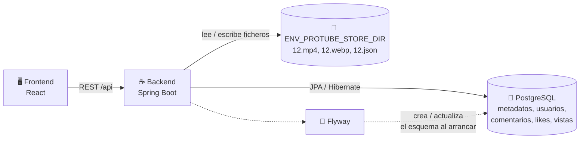

| Qué | Dónde se guarda | Por qué |
|---|---|---|
| Vídeos (`.mp4`) y miniaturas (`.webp`) | Disco, en `ENV_PROTUBE_STORE_DIR` | Son ficheros grandes; en la BD harían las copias y consultas lentísimas |
| Título, descripción, autor, tags, categorías… | PostgreSQL (`videos`, `tags`, …) | Se consultan, filtran y editan |
| Usuarios, comentarios, likes, visualizaciones | PostgreSQL | Datos relacionales que necesitan integridad |

La tabla `videos` solo guarda el **nombre** del fichero (`file_name = '12.mp4'`); el backend construye la ruta
completa con `ENV_PROTUBE_STORE_DIR`.

### Perfiles de Spring

| Perfil | Base de datos | ¿Quién crea las tablas? | Uso |
|---|---|---|---|
| `dev` | H2 en memoria | Hibernate (`ddl-auto=update`) | Desarrollo rápido sin Docker |
| `prod` | PostgreSQL | **Flyway** (`ddl-auto=validate`) | Run config "Production" y entrega con `docker compose` |

> ⚠️ Los scripts de Flyway están escritos para PostgreSQL, por eso Flyway está desactivado en `dev`.
> Antes de dar algo por bueno, pruébalo también con el perfil `prod`.

---

## 2. Cómo se crea y evoluciona el esquema (Flyway)

### ¿Qué es Flyway?

Una herramienta que ejecuta scripts SQL **versionados** y en orden. Los scripts están en:

```
backend/src/main/resources/db/migration/
├── V1__init_schema.sql                  ← esquema inicial
├── V2__authentication.sql               ← auth_accounts, auth_tokens
├── V3__studio_videos.sql                ← studio_videos (cola de subida de Studio)
├── V4__add_video_visibility_status.sql  ← videos.visibility y videos.status
├── V5__playlists.sql                    ← playlists, playlist_videos
└── V6__studio_publishes_to_videos.sql   ← Studio publica en videos (publish_at, age_restricted, UNLISTED…)
```

El nombre sigue el formato `V<número>__<descripción>.sql` (dos guiones bajos).

### Qué hace al arrancar el backend

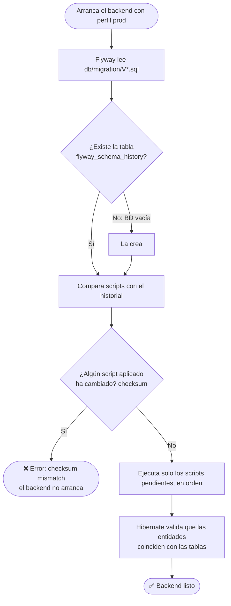

### La tabla `flyway_schema_history`

Es el "registro" de Flyway: una fila por script aplicado. **No se toca a mano y no necesita entidad JPA.**

| version | description | checksum | installed_on | success |
|---|---|---|---|---|
| 1 | init schema | 123456789 | 2026-10-15 10:00 | t |

Gracias a ella:
- Cada base de datos (la tuya, la de un compañero, la de Docker) **se pone al día sola** al arrancar.
- Si alguien edita un script ya aplicado, el **checksum** no coincide y Flyway lo detecta.

### 📏 Reglas de oro

| ✅ Hacer | ❌ No hacer |
|---|---|
| Crear `V2__add_favorites.sql` para cualquier cambio | Editar `V1__init_schema.sql` una vez está en `develop`/`main` |
| Un script = un cambio coherente | Mezclar cambios no relacionados en un script |
| Actualizar **este documento** en el mismo PR | Cambiar las tablas desde DBeaver/pgAdmin a mano |
| Ajustar las entidades JPA a la vez que el SQL | Confiar en `ddl-auto=update` para producción |

> 💡 **Excepción:** mientras V1 no esté compartida (no está en `develop`/`main`) se puede editar. La BD local
> ya creada dará *checksum mismatch*; hay que borrarla y recrearla (ver [cheatsheet](#10-operaciones-habituales-cheatsheet)).

---

## 3. Modelo de datos

### Vista rápida por dominios

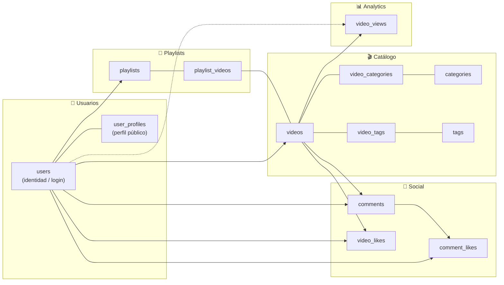

### Diagrama entidad-relación completo

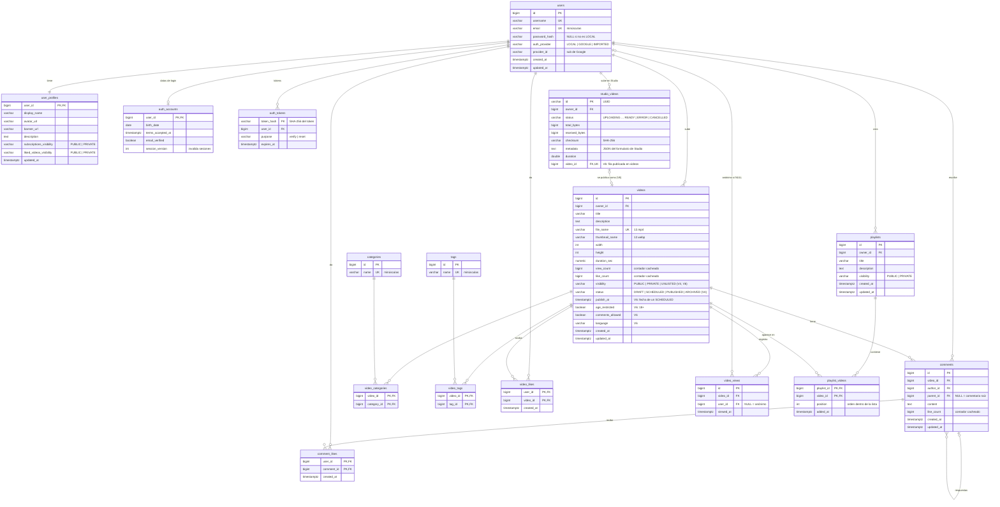

### Tabla → requisito

| Tabla | Para qué sirve | Requisitos |
|---|---|---|
| `users` | Identidad: registro/login local, OAuth Google y canales importados | US-01, US-02, US-03 |
| `user_profiles` | Perfil público: nombre visible, avatar, banner, descripción y privacidad | Epic 2 (perfil) |
| `videos` | Catálogo, reproducción, subida y edición | US-04 … US-07 |
| `categories`, `tags` + `video_categories`, `video_tags` | Metadatos editables (relación N:M) | US-07 |
| `comments` | Comentarios y respuestas en hilo | US-09, US-10 |
| `comment_likes`, `video_likes` | Un like por usuario | US-10, US-11 |
| `video_views` | Una fila por reproducción → gráficas por fecha | US-11 |
| `playlists`, `playlist_videos` (V5) | Listas de vídeos de un usuario; las públicas salen en la búsqueda | US-08 |
| `auth_accounts`, `auth_tokens` (V2) | Fecha de nacimiento, términos, email verificado y tokens de verificación/recuperación | US-01, US-02 |
| `studio_videos` (V3, V6) | Cola de subida y conversión de Studio; al terminar se publica en `videos` | US-06, US-07 |

### Convenciones del esquema

| Convención | Ejemplo | Motivo |
|---|---|---|
| Nombres en `snake_case`, tablas en plural | `video_views.viewed_at` | Postgres pasa todo a minúsculas; evita comillas |
| PK `BIGINT GENERATED ALWAYS AS IDENTITY` | `id` | Estándar SQL, secuencial, no se desborda |
| Fechas `TIMESTAMPTZ` | `created_at` | Guarda el instante exacto, sin líos de zona horaria |
| Tablas puente con PK compuesta | `PRIMARY KEY (video_id, tag_id)` | Impide duplicados sin columna `id` extra |
| Prefijos de nombres | `ix_` índice, `ux_` índice único, `chk_` CHECK | Se sabe qué es cada cosa en un error |

---

## 4. Tablas en detalle

### 👤 `users` — un único modelo para tres tipos de usuario

| `auth_provider` | Cómo nace | `email` | `password_hash` | `provider_id` |
|---|---|---|---|---|
| `LOCAL` | Formulario de registro | ✅ obligatorio | ✅ obligatorio (BCrypt) | — |
| `GOOGLE` | Primer login con Google | ✅ (de Google) | — | ✅ `sub` de Google |
| `IMPORTED` | Autor/canal del JSON del videoGrabber | — | — | — |

> Un usuario `IMPORTED` no puede iniciar sesión (no tiene credenciales): solo existe para ser autor de
> vídeos y comentarios importados.

### 🪪 `users` vs `user_profiles` — identidad separada del perfil

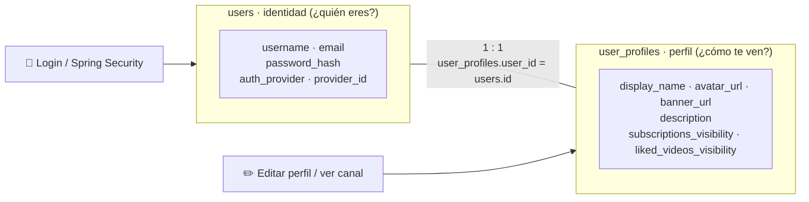

| | `users` | `user_profiles` |
|---|---|---|
| Responde a | ¿Quién eres y cómo entras? | ¿Qué se muestra de ti? |
| Lo usa | Login, registro, OAuth (`UserDetailsService`) | Página de canal, editor de perfil |
| Cambia | Casi nunca | A menudo |
| Clave | `id` | `user_id` (PK **y** FK a `users.id`) |

**Por qué:** el login solo carga lo que necesita (credenciales), y editar el perfil nunca toca la entidad que usa
Spring Security. Además añadir campos de perfil no afecta al código de autenticación.

**Visibilidad** (`subscriptions_visibility`, `liked_videos_visibility`):

| Valor | Quién ve la lista |
|---|---|
| `PRIVATE` *(por defecto)* | Solo el propio usuario |
| `PUBLIC` | Cualquiera que visite su canal |

> ℹ️ `subscriptions_visibility` se deja preparado para la mejora "Subscriptions to other users"; la tabla de
> suscripciones todavía no existe.

### 🎬 `videos`

- `file_name` / `thumbnail_name` → ruta relativa a `ENV_PROTUBE_STORE_DIR` (vídeos importados) o ruta absoluta
  `/api/studio/play/{id}/…` (vídeos publicados desde Studio). `file_name` es único.
- `view_count` / `like_count` → **contadores cacheados** (ver más abajo).
- `visibility` y `status` (V4) → quién puede ver el vídeo y en qué punto de su ciclo de vida está:

| `status` | Significado |
|---|---|
| `DRAFT` | Borrador, aún no publicado |
| `SCHEDULED` | Se publicará en `publish_at` (V6); el worker de Studio lo pasa a `PUBLISHED` cuando llega la hora |
| `PUBLISHED` *(por defecto)* | Publicado |
| `ARCHIVED` | Retirado, ya no se muestra |

| `visibility` | Quién lo ve |
|---|---|
| `PUBLIC` *(por defecto)* | Cualquiera (si está `PUBLISHED`) |
| `UNLISTED` (V6) | Quien tenga el enlace; no sale en catálogo ni búsqueda |
| `PRIVATE` | Solo su propietario |

> Un vídeo aparece en el catálogo, admite comentarios y se ve en el canal de otros usuarios **solo si**
> `status = 'PUBLISHED' AND visibility = 'PUBLIC'`. Los vídeos importados quedan así por defecto.
> Si además `age_restricted = TRUE` (V6), el catálogo solo lo muestra a mayores de edad y a su propietario, y la
> búsqueda no lo indexa.

#### Vídeos de Studio (V3 + V6)

`studio_videos` es la **cola de subida y conversión** (bytes recibidos, checksum, estado, error de FFmpeg y el JSON
del formulario). Cuando un vídeo queda `READY`, `StudioPublisher` crea su fila en `videos` y la enlaza con
`studio_videos.video_id`; cada edición en Studio la sincroniza (título, descripción, visibilidad, estado,
`publish_at`, 18+, comentarios, idioma, tags y categoría). Así el catálogo, los comentarios, las playlists y la
búsqueda funcionan igual para vídeos importados y subidos. Detalle en [STUDIO.md](STUDIO.md).

#### `auth_accounts` / `auth_tokens` (V2)

- `auth_accounts`: datos de login que no son del perfil (1:1 con `users`): fecha de nacimiento (edad mínima y
  contenido 18+), aceptación de términos, email verificado y `session_version` (subirla invalida las sesiones abiertas).
- `auth_tokens`: tokens de verificación de email y de recuperación de contraseña. Solo se guarda su **hash**
  SHA-256 (`token_hash`), nunca el token, con `purpose` y caducidad.

#### ¿Por qué hay contadores si ya existen `video_views` y `video_likes`?

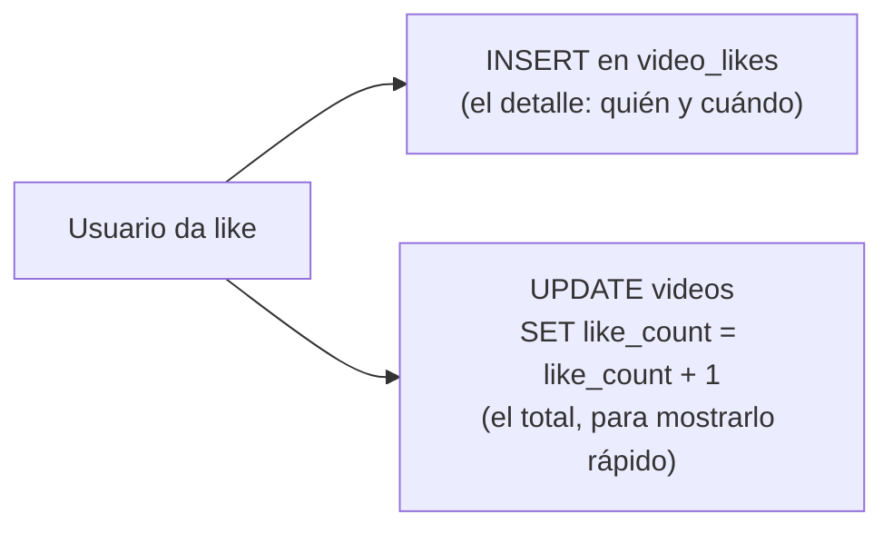

- Mostrar "1.234 likes" en el catálogo no debería obligar a contar filas de `video_likes` en cada petición.
- Las tablas de detalle permiten las **gráficas por fecha** de analytics.
- Los vídeos importados traen sus contadores del JSON, aunque no tengan filas de detalle.

### 🏷️ `categories` y `tags`

Relación **N:M** con `videos` (un vídeo tiene varios tags y un tag está en varios vídeos), por eso las tablas
puente. Los nombres se guardan **en minúsculas**: `Music` y `music` son el mismo tag.

### 💬 `comments` — hilos con `parent_id`

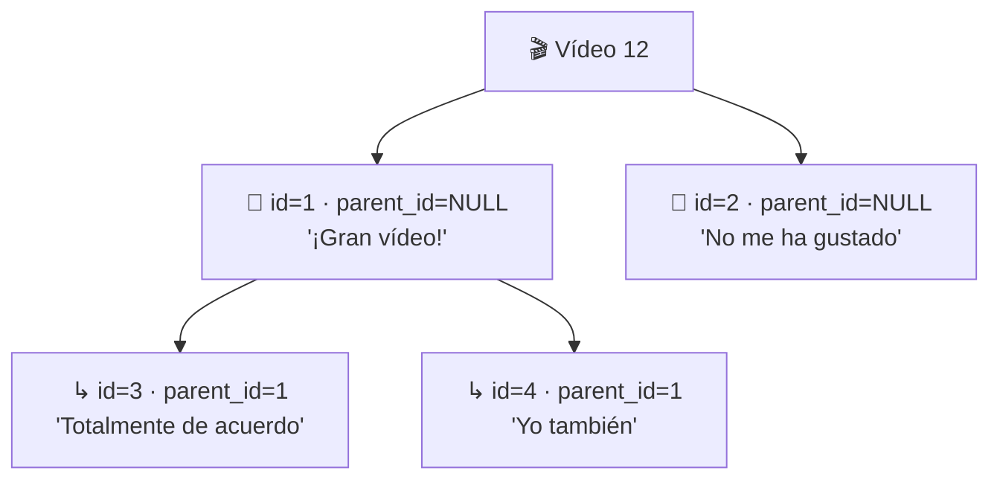

- `parent_id IS NULL` → comentario raíz.
- `parent_id = X` → respuesta al comentario `X` (del **mismo vídeo**, lo valida el servicio).

### ❤️ `video_likes` / `comment_likes`

La clave primaria es `(user_id, video_id)` / `(user_id, comment_id)`: la BD **impide** que un usuario dé dos
likes a lo mismo. Quitar el like = borrar la fila.

### 📃 `playlists` / `playlist_videos` (V5)

- Un usuario crea playlists `PUBLIC` (las ve cualquiera y salen en la búsqueda) o `PRIVATE` (solo él).
- `playlist_videos` tiene PK `(playlist_id, video_id)`: un vídeo aparece **una vez** por lista. `position` guarda el
  orden (el servicio añade al final con `MAX(position) + 1`).
- Admiten cualquier vídeo de `videos`, también los subidos con Studio una vez publicados (V6).
- Quien no es el propietario solo ve los vídeos `PUBLISHED` + `PUBLIC` de la lista.

### 📊 `video_views`

Una fila por reproducción. `user_id` es `NULL` si quien mira no ha iniciado sesión. Ejemplo de consulta para
la gráfica de analytics:

```sql
SELECT date_trunc('day', viewed_at) AS dia, COUNT(*) AS vistas
FROM video_views
WHERE video_id = :videoId
GROUP BY dia
ORDER BY dia;
```

---

## 5. Reglas que el backend debe cumplir

La BD **rechaza** con un error de constraint cualquier dato que no siga estas reglas. Si ves un
`DataIntegrityViolationException`, busca aquí el nombre de la constraint.

| Regla | Dónde aplica en el código | Lo garantiza |
|---|---|---|
| `users.email`, `tags.name` y `categories.name` se guardan **en minúsculas** (`.toLowerCase()`) | Registro, login, importador, editor de metadatos | `chk_users_email_lowercase`, `chk_tags_name_lowercase`, `chk_categories_name_lowercase` |
| Login con Google: buscar por `auth_provider = 'GOOGLE'` + `provider_id` | Login OAuth | `ux_users_provider` (único) |
| Usuario `LOCAL` siempre con email y `password_hash` | Registro | `chk_users_local_has_credentials` |
| `auth_provider` solo `LOCAL`, `GOOGLE` o `IMPORTED` | Enum Java | `chk_users_provider` |
| **Todo usuario tiene su fila en `user_profiles`**, creada en la **misma transacción** que el usuario | Registro, primer login con Google, importador | ⚠️ **Solo el servicio** (la BD no lo puede exigir) |
| Visibilidades solo `PUBLIC` o `PRIVATE` (por defecto `PRIVATE`) | Enum Java, editor de perfil | `chk_user_profiles_subscriptions_visibility`, `chk_user_profiles_liked_videos_visibility` |
| Respetar la visibilidad: si es `PRIVATE`, la API no devuelve la lista a otros usuarios | Endpoints de canal / likes / suscripciones | ⚠️ **Solo el servicio** |
| Contadores nunca negativos | Likes / quitar like | `chk_videos_view_count_positive`, `chk_videos_like_count_positive`, `chk_comments_like_count_positive` |
| `width`, `height` > 0 y `duration_sec` ≥ 0 (o `NULL`) | Subida e importación | `chk_videos_width_positive`, `chk_videos_height_positive`, `chk_videos_duration_positive` |
| Comentario no vacío | Comentar / responder | `chk_comments_content_not_blank` |
| `videos.visibility` solo `PUBLIC`/`PRIVATE`/`UNLISTED`; `videos.status` solo `DRAFT`/`SCHEDULED`/`PUBLISHED`/`ARCHIVED` | Enums Java, Studio, canal | `chk_videos_visibility`, `chk_videos_status` |
| Un vídeo `SCHEDULED` siempre tiene `publish_at` | `StudioPublisher` | `chk_videos_scheduled_has_date` |
| Los vídeos de Studio solo llegan a `videos` cuando están `READY`, y se re-sincronizan al editarlos | `StudioPublisher` (worker y edición) | ⚠️ **Solo el servicio** |
| Contenido 18+ solo para mayores de edad y su propietario | `CatalogController`, `SearchIndexer` | ⚠️ **Solo el servicio** |
| Catálogo, comentarios y canal ajeno solo con vídeos `PUBLISHED` + `PUBLIC` | `CatalogController`, `CommentService`, `ChannelVideoService` | ⚠️ **Solo el servicio** |
| Playlist con título no vacío y visibilidad `PUBLIC`/`PRIVATE` | `PlaylistService` | `chk_playlists_title_not_blank`, `chk_playlists_visibility` |
| Solo el propietario modifica una playlist; las `PRIVATE` solo las ve él | `PlaylistService` | ⚠️ **Solo el servicio** |
| Un vídeo una sola vez por playlist | `PlaylistService` (`ON CONFLICT DO NOTHING`) | PK `(playlist_id, video_id)` |
| `username`, `email` y `file_name` únicos | Registro, subida, importador | `UNIQUE` |
| Una respuesta debe ser del **mismo vídeo** que su padre | Servicio de comentarios | ⚠️ **Solo el servicio** (no la BD) |

### Cómo dar un like correctamente

Hay que hacerlo **en la BD y de forma atómica**, no leyendo el contador en Java y guardándolo:

```sql
-- 1. Registrar el like (si ya existía, no hace nada)
INSERT INTO video_likes (user_id, video_id) VALUES (:userId, :videoId)
ON CONFLICT DO NOTHING;

-- 2. Solo si el INSERT ha insertado una fila:
UPDATE videos SET like_count = like_count + 1 WHERE id = :videoId;
```

> ❌ `video.setLikeCount(video.getLikeCount() + 1)` pierde likes si dos usuarios pulsan a la vez.

---

## 6. Qué pasa al borrar

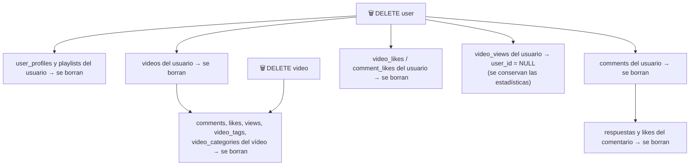

| Se borra… | Efecto |
|---|---|
| Un usuario | Se borran su perfil, sus playlists, sus vídeos, comentarios y likes. Sus visualizaciones quedan como anónimas |
| Un vídeo | Se borran sus comentarios, likes, vistas, enlaces a tags/categorías y su presencia en playlists. **Los tags, categorías y playlists se mantienen** |
| Una playlist | Se borran sus filas de `playlist_videos` (los vídeos no) |
| Un vídeo publicado desde Studio | Su `studio_videos.video_id` pasa a `NULL` (la subida se conserva) |
| Un comentario | Se borran sus respuestas y sus likes |
| Un tag o categoría | Desaparece de todos los vídeos (el vídeo no se borra) |

> ⚠️ Borrar un vídeo de la BD **no** borra el `.mp4`/`.webp` del disco: eso lo tiene que hacer el servicio.

---

## 7. Índices y para qué sirven

Postgres crea índices automáticos para las `PRIMARY KEY` y los `UNIQUE`. El resto se crean a mano en las migraciones:

| Índice | Columnas | Acelera… |
|---|---|---|
| `ix_videos_owner_status_created` (V4) | `videos(owner_id, status, created_at DESC)` | "Vídeos publicados de este canal, más nuevos primero" y borrados en cascada. Sustituye a `ix_videos_owner` (V1), que se borra por redundante |
| `ix_videos_created_at` | `videos(created_at DESC)` | Listado del catálogo, más nuevos primero |
| `ix_video_categories_category` | `video_categories(category_id)` | "Vídeos de esta categoría" |
| `ix_video_tags_tag` | `video_tags(tag_id)` | "Vídeos con este tag" |
| `ix_comments_video` | `comments(video_id, created_at)` | Comentarios de un vídeo ordenados |
| `ix_comments_parent` | `comments(parent_id)` | Respuestas de un comentario |
| `ix_comments_author` | `comments(author_id)` | Comentarios de un usuario |
| `ix_comment_likes_comment` | `comment_likes(comment_id)` | Likes de un comentario |
| `ix_video_likes_video` | `video_likes(video_id, created_at)` | Likes de un vídeo y gráficas por fecha |
| `ix_video_views_video_date` | `video_views(video_id, viewed_at)` | Gráficas de vistas por día |
| `ix_video_views_user` | `video_views(user_id)` | Historial de un usuario, borrado de usuario |
| `ux_users_provider` | `users(auth_provider, provider_id)` | Login con Google (y evita duplicados) |
| `ix_playlists_owner` (V5) | `playlists(owner_id, created_at DESC)` | "Tus playlists", más nuevas primero |
| `ix_playlist_videos_video` (V5) | `playlist_videos(video_id)` | Borrar un vídeo (cascada) |
| `ix_videos_scheduled` (V6, **parcial**) | `videos(publish_at) WHERE status = 'SCHEDULED'` | Encontrar cada 30 s los programados que ya toca publicar; solo indexa esas filas |
| `ix_auth_tokens_user` (V2) | `auth_tokens(user_id)` | Tokens de un usuario, borrado en cascada |
| `ix_studio_owner`, `ix_studio_status` (V3) | `studio_videos(owner_id)`, `(status, created_at)` | "Mis vídeos" en Studio y la cola del worker |

> `user_profiles.user_id` no necesita índice propio: al ser la PK ya lo tiene.
>
> Regla aplicada: **toda clave foránea tiene un índice** que empieza por ella. Postgres no los crea solo y sin
> ellos los JOIN y los `ON DELETE CASCADE` recorren la tabla entera.

---

## 8. Importación del videoGrabber

Al arrancar con perfil `prod`, `AppStartupRunner` llama a `VideoImporter`, que lee cada `<id>.json` de
`ENV_PROTUBE_STORE_DIR` y lo reparte así (cada vídeo en **una transacción**: o se guarda entero o nada). Los ya
importados (mismo `file_name`) se saltan, así que reiniciar no duplica nada; un JSON roto se registra en el log y
se salta.

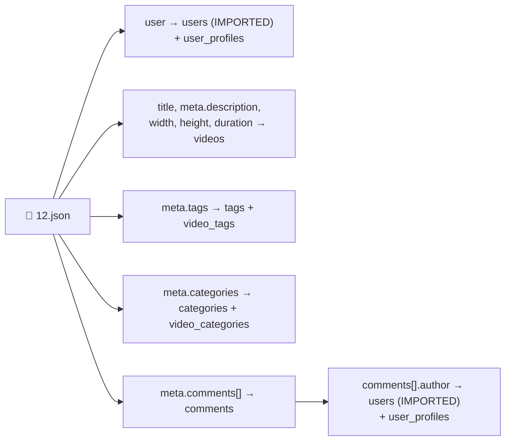

| Campo del JSON | Destino | Nota |
|---|---|---|
| `user` | `users.username` (`IMPORTED`) + `user_profiles.display_name` | Reutilizar si ya existe. Crear también su perfil (visibilidades por defecto) |
| `title` | `videos.title` | |
| `meta.description` | `videos.description` | |
| `width`, `height`, `duration` | `videos.width/height/duration_sec` | |
| `timestamp` (epoch, segundos) | `videos.created_at` | Fecha original de publicación |
| `meta.view_count`, `meta.like_count` | `videos.view_count`, `videos.like_count` | Contadores iniciales (sin filas de detalle) |
| `<id>.mp4` / `<id>.webp` | `videos.file_name` / `thumbnail_name` | |
| `meta.tags[]` | `tags.name` + `video_tags` | **En minúsculas**, reutilizar si existe |
| `meta.categories[]` | `categories.name` + `video_categories` | **En minúsculas**, reutilizar si existe |
| `meta.comments[].author` | `users.username` (`IMPORTED`) + `user_profiles.display_name` | Igual que `user` |
| `meta.comments[].text` | `comments.content` | Saltar los vacíos |
| `meta.comments[].like_count` | `comments.like_count` | |
| `meta.comments[].timestamp` | `comments.created_at` | |
| `meta.channel_follower_count` | — | No se guarda (no hay suscripciones en el MVP) |

> 💡 El `username` es único entre **todos** los usuarios. Si el nombre del canal ya pertenece a una cuenta real
> (`LOCAL`/`GOOGLE`), el importador usa `yt_<nombre>`. Si ya existe como `IMPORTED`, lo reutiliza.

**Vídeos de prueba:** con `pro_tube.sample_videos=true` (variable `ENV_PROTUBE_SAMPLE_VIDEOS`, por defecto `true`) se
importan además los 24 vídeos de `samples/sample-videos.json` (`file_name = sample-N.mp4`, sin fichero real) como
canales `IMPORTED`. Son filas normales de Postgres: aparecen en el catálogo, se pueden buscar, comentar y añadir a
playlists. Para no cargarlos: `ENV_PROTUBE_SAMPLE_VIDEOS=false` (los ya importados hay que borrarlos a mano:
`DELETE FROM videos WHERE file_name LIKE 'sample-%';`).

---

## 9. Mapeo a entidades JPA

Como Hibernate está en `validate`, las entidades deben coincidir **exactamente** con el SQL:

| Tipo SQL | Tipo Java | Anotación |
|---|---|---|
| `BIGINT GENERATED ALWAYS AS IDENTITY` | `Long` | `@Id @GeneratedValue(strategy = GenerationType.IDENTITY)` |
| `VARCHAR(n)` | `String` | `@Column(length = n)` |
| `TEXT` | `String` | `@Column(columnDefinition = "text")` |
| `TIMESTAMPTZ` | `Instant` (o `OffsetDateTime`) | `@CreationTimestamp` / `@UpdateTimestamp` |
| `NUMERIC(10,2)` | `BigDecimal` | `@Column(precision = 10, scale = 2)` |
| `auth_provider` | `enum AuthProvider` | `@Enumerated(EnumType.STRING)` |
| `*_visibility` | `enum Visibility { PUBLIC, PRIVATE }` | `@Enumerated(EnumType.STRING)` |
| `user_profiles.user_id` (PK = FK) | `User user` en `UserProfile` | `@Id Long userId` + `@OneToOne @MapsId` |
| Tabla puente (`video_tags`) | `Set<Tag>` | `@ManyToMany` + `@JoinTable` |
| `parent_id` | `Comment parent` | `@ManyToOne` |

> ❌ No uses `LocalDateTime` para `TIMESTAMPTZ`: pierde la zona horaria.
> ℹ️ `updated_at` no tiene trigger en la BD: se actualiza solo vía `@UpdateTimestamp`.

---

## 10. Operaciones habituales (cheatsheet)

> En Git Bash (Windows) antepón `MSYS_NO_PATHCONV=1` a los comandos `docker` para que no traduzca las rutas.

| Quiero… | Comando |
|---|---|
| Levantar Postgres | `docker compose up -d` |
| Abrir una consola SQL | `docker exec -it postgres_db psql -U admin -d postgres` |
| Ver las tablas | `\dt` dentro de `psql` |
| Ver la estructura de una tabla | `\d videos` dentro de `psql` |
| Ver qué migraciones hay aplicadas | `docker exec postgres_db psql -U admin -d postgres -c "SELECT version, description, success FROM flyway_schema_history;"` |
| Borrar todo el esquema (empezar de cero) | `docker exec postgres_db psql -U admin -d postgres -c "DROP SCHEMA public CASCADE; CREATE SCHEMA public;"` |
| Borrar también el contenedor y sus datos | `docker compose down -v` |
| Aplicar las migraciones | Arrancar el backend con la run config **Production** |
| Aplicar las migraciones **sin arrancar el backend** | `docker run --rm --network container:postgres_db -v "<ruta>/backend/src/main/resources/db/migration:/flyway/sql:ro" flyway/flyway:10.10 -url=jdbc:postgresql://localhost:5432/postgres -user=admin -password=password migrate` |

### Añadir un cambio al esquema (paso a paso)

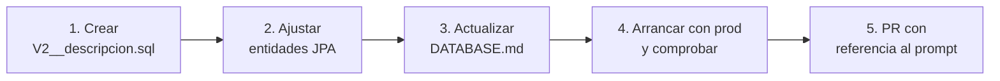

1. Crear `backend/src/main/resources/db/migration/V2__descripcion.sql` (siguiente número libre).
2. Ajustar las entidades JPA (si no, `ddl-auto=validate` no deja arrancar).
3. Actualizar **este documento**: diagrama, tabla y reglas del backend si cambian.
4. Arrancar con perfil `prod` y comprobar `flyway_schema_history`.
5. Abrir PR (si se ha usado IA, guardar el prompt en `prompts/` y referenciarlo — NFR-07).

### Errores típicos

| Error | Causa | Solución |
|---|---|---|
| `Validate failed: Migration checksum mismatch for migration version 1` | Se ha editado un script ya aplicado | Si no está compartido: borrar el esquema y rearrancar. Si lo está: deshacer la edición y crear una V2 |
| `Schema-validation: missing column [...]` | La entidad JPA no coincide con el SQL | Ajustar la entidad o crear una migración |
| `violates check constraint "chk_..."` | Dato que no cumple una regla | Ver [reglas del backend](#5-reglas-que-el-backend-debe-cumplir) |
| `duplicate key value violates unique constraint` | Email, username, tag… repetido | Comprobar si ya existe antes / reutilizarlo |

---

## 11. Búsqueda con MongoDB (US-08)

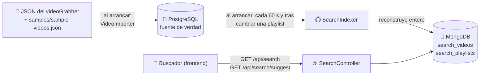

PostgreSQL sigue siendo la **fuente de verdad**: MongoDB solo guarda una **copia de lectura** que se puede borrar
y regenerar en cualquier momento. Por eso el contenedor `mongo_search` del `compose.yaml` no tiene volumen.

| Pieza | Qué hace |
|---|---|
| `search_videos` | Un documento por vídeo: `title`, `channel`, `tags`, `description`, `durationSec`, `views`, `createdAt`, copias normalizadas (minúsculas, sin tildes) `titleNorm`/`channelNorm` y `terms` (palabras de 3+ letras, para corregir erratas) |
| `search_playlists` | Una por playlist **pública**: `title`, `owner`, `description`, `videoCount`, `createdAt`, `terms` |
| Índices de texto (idioma `spanish`) | Vídeos: título 10 · tags 5 · canal 3 · descripción 1. Playlists: título 10 · propietario 3 · descripción 1. Ignoran tildes y mayúsculas y entienden plurales (`guitarras` → `guitarra`) |
| Corrección de erratas | Si la búsqueda no da **nada**, cada palabra se cambia por la más parecida del vocabulario (`terms`): completa palabras cortadas (`guit` → `guitarra`), y admite 1 error en palabras de 4-7 letras y 2 en las de 8+ (letra cambiada, de más, de menos o dos letras intercambiadas). La respuesta lleva `approximate: true` y `correctedQuery` |
| `SearchIndexer` | Al arrancar, cada `pro_tube.search.reindex-ms` (60 s) y tras cada cambio en una playlist. Construye colecciones `*_tmp` y las renombra (cambio atómico: nunca se ven a medias). Si Mongo está caído, lo registra y reintenta |

**Qué se indexa:**
- Vídeos de `videos` con `status = 'PUBLISHED' AND visibility = 'PUBLIC' AND age_restricted = FALSE`: importados,
  de prueba y publicados desde Studio (V6). Un vídeo programado aparece como mucho ~90 s después de su hora
  (30 s del worker que lo publica + 60 s del reindexado).
- Playlists `PUBLIC`.

**API:**

| Endpoint | Parámetros | Devuelve |
|---|---|---|
| `GET /api/search` | `q`, `type` (`all`/`video`/`channel`/`playlist`), `date` (`any`/`today`/`week`/`month`/`year`), `duration` (`any`/`short` <4 min/`medium` 4-20/`long` >20), `sort` (`relevance`/`date`/`views`), `channel` (nombre exacto), `page`, `size` (máx. 48) | `videos`, `videoTotal`, `channels` (nombre, nº de vídeos, visualizaciones), `channelTotal`, `playlists` (id, título, propietario, nº de vídeos), `playlistTotal`, `hasMore`, `approximate`, `correctedQuery` |
| `GET /api/search/suggest` | `q` | Hasta 8 títulos y canales con una palabra que empieza por `q` |
| `GET /api/playlists/mine?videoId=` | — (sesión) | Mis playlists, con `hasVideo` para ese vídeo |
| `POST /api/playlists` | `{title, description, visibility}` (sesión) | La playlist creada |
| `GET /api/playlists/{id}` | — | La playlist y sus vídeos (las privadas, solo su propietario) |
| `DELETE /api/playlists/{id}` | — (sesión, propietario) | Borra la playlist |
| `POST /api/playlists/{id}/videos` / `DELETE /api/playlists/{id}/videos/{videoId}` | `{videoId}` (sesión, propietario) | Añade o quita un vídeo |

Con `type=all`, la primera página de una búsqueda con texto incluye además hasta 4 canales y 4 playlists. Las
peticiones que modifican playlists necesitan la cabecera `X-Protube-Request: 1` (protección CSRF de `AuthGuard`).

Un valor desconocido en un filtro se trata como el valor por defecto, y `q` vacío devuelve todo: la búsqueda nunca
da error por la entrada. Si Mongo no responde, la API devuelve **503** con un mensaje.

**Configuración:** `ENV_PROTUBE_MONGO_URI` (por defecto `mongodb://localhost:27017/protube`). Levantar Mongo con
`docker compose up -d search`.

> ⚠️ El importador, las playlists y la búsqueda con datos necesitan el perfil `prod` (Postgres con Flyway). Con
> `dev` (H2) no existen esas tablas: la app arranca, pero la búsqueda sale vacía y las playlists dan error.
