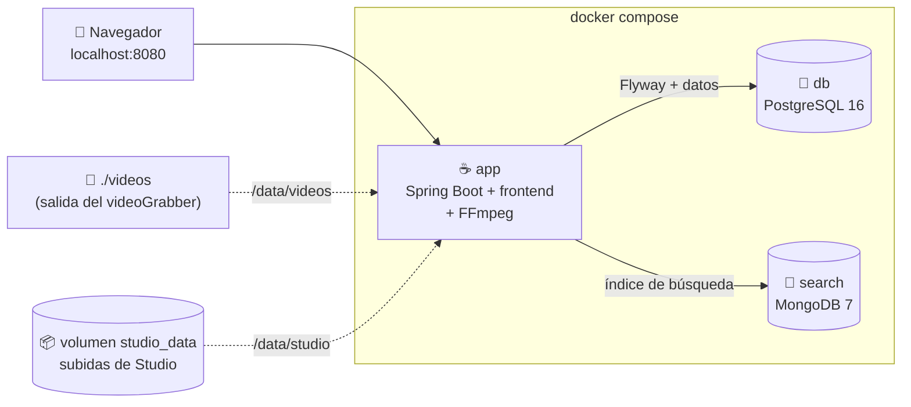

# 🐳 ProTube con Docker

Todo ProTube (backend, frontend, bases de datos y **FFmpeg**) se levanta con Docker Compose. No hace falta
instalar Java, Node ni FFmpeg en tu máquina: solo [Docker Desktop](https://www.docker.com/products/docker-desktop/).



## Arrancar todo

```bash
docker compose up -d --build
```

Abre **http://localhost:8080**. La primera vez tarda unos minutos (descarga Maven, Node y FFmpeg y compila).

Al arrancar, la app:
1. Espera a que Postgres esté listo y aplica las migraciones de Flyway (`V1…V6`).
2. Importa los JSON del videoGrabber que haya en la carpeta montada (y los 24 vídeos de prueba).
3. Construye el índice de búsqueda en MongoDB.

| Servicio | Contenedor | Puerto | Para qué |
|---|---|---|---|
| `app` | `protube_app` | 8080 | Backend + frontend + FFmpeg |
| `db` | `postgres_db` | 5432 | Datos (fuente de verdad) |
| `search` | `mongo_search` | 27017 | Índice de búsqueda |

## Qué hace FFmpeg

La imagen `app` incluye `ffmpeg` y `ffprobe` (paquete de Debian, con `libx264` y `libvpx`). Studio los usa para:

| Paso | Herramienta | Resultado |
|---|---|---|
| Comprobar el archivo subido y medir su duración | `ffprobe` | Rechaza archivos corruptos o de más de 20 min |
| Convertir a varias calidades | `ffmpeg` (H.264) | `360.mp4`, `720.mp4`, `1080.mp4` |
| Generar miniaturas | `ffmpeg` | `auto-1.jpg`, `auto-2.jpg`, `auto-3.jpg` (640×360) |

Los archivos van al volumen `studio_data` (`/data/studio`), fuera de `/media`; el backend los sirve en
`/api/studio/play/{id}/…` comprobando que el vídeo sea visible para quien lo pide.

## Variables de entorno

Se leen de tu entorno o de un fichero `.env` junto a `compose.yaml`. Todas tienen un valor por defecto:

| Variable | Por defecto | Para qué |
|---|---|---|
| `ENV_PROTUBE_DB` | `postgres` | Nombre de la base de datos |
| `ENV_PROTUBE_DB_USER` / `ENV_PROTUBE_DB_PASS` | `admin` / `password` | Credenciales de Postgres |
| `ENV_PROTUBE_STORE_DIR` | `./videos` | Carpeta **del host** con los vídeos del videoGrabber |
| `ENV_PROTUBE_SAMPLE_VIDEOS` | `true` | Importar los 24 vídeos de prueba |
| `ENV_PROTUBE_GOOGLE_CLIENT_ID` / `_SECRET` | vacío | Login con Google (opcional) |

Dentro del contenedor ya están fijadas `PROTUBE_STUDIO_FFMPEG=ffmpeg`, `PROTUBE_STUDIO_FFPROBE=ffprobe`,
`ENV_PROTUBE_STORE_DIR=/data/videos/` y `PROTUBE_STUDIO_DIRECTORY=/data/studio`.

## Desarrollar con el IDE

Si prefieres arrancar el backend y el frontend desde IntelliJ/Vite, levanta solo las bases de datos:

```bash
docker compose up -d db search
```

y usa la run config **Production**. Para que Studio convierta vídeos fuera de Docker necesitas FFmpeg instalado
(ver [STUDIO.md](STUDIO.md)). ⚠️ No arranques a la vez el contenedor `app` y el backend del IDE: los dos usan el
puerto 8080.

## Tests del backend con FFmpeg

Los tests de conversión de Studio solo se ejecutan si hay FFmpeg; sin él se saltan y la comprobación de
cobertura de JaCoCo falla en `VideoProcessor`. Para pasarlos completos en cualquier máquina:

```bash
docker compose run --rm backend-tests
```

Ejecuta `mvn clean verify` dentro de un contenedor con Java 21, Maven y FFmpeg. Los tests que usan Testcontainers
(Postgres, MongoDB) lanzan sus contenedores a través del Docker del host (se monta `/var/run/docker.sock`). La
carpeta `backend/` se monta, así que el informe queda en `backend/target/site/jacoco/`.

## Operaciones habituales

| Quiero… | Comando |
|---|---|
| Ver los logs de la app | `docker compose logs -f app` |
| Reconstruir tras cambiar código | `docker compose up -d --build app` |
| Parar todo (sin perder datos) | `docker compose down` |
| Borrar también los datos | `docker compose down -v` |
| Consola SQL | `docker exec -it postgres_db psql -U admin -d postgres` |
| Comprobar FFmpeg en la imagen | `docker compose exec app ffmpeg -version` |
