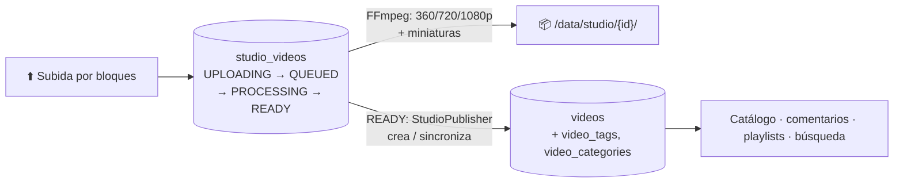

# Studio: subida y edición (US06 y US07)

Arranca el backend y el frontend como se describe en [Autenticación y home](AUTHENTICATION_AND_HOME.md). En desarrollo puedes entrar con `admin` / `admin`. Pulsa **Subir contenido** en la cabecera o abre `http://localhost:5173/#/studio`.

## Preparar el procesamiento

> 🐳 **La forma recomendada es Docker:** la imagen de la app ya trae FFmpeg y FFprobe configurados
> (`docker compose up -d --build`, ver [DOCKER.md](DOCKER.md)). Lo que sigue solo hace falta si arrancas el backend
> desde el IDE y quieres que Studio convierta vídeos.

El servidor necesita **FFmpeg** y **FFprobe** con el codificador `libx264`. Puedes obtenerlos desde la [página oficial de descargas](https://ffmpeg.org/download.html). Añade la carpeta `bin` a `PATH` o indica las rutas completas con estas variables de entorno antes de arrancar el backend:

| Variable | Valor por defecto |
| --- | --- |
| `PROTUBE_STUDIO_FFMPEG` | `ffmpeg` |
| `PROTUBE_STUDIO_FFPROBE` | `ffprobe` |
| `PROTUBE_STUDIO_MAX_BYTES` | `104857600` (100 MiB) |
| `PROTUBE_STUDIO_MAX_SECONDS` | `1200` (20 minutos) |
| `PROTUBE_STUDIO_DIRECTORY` | Carpeta hermana de `ENV_PROTUBE_STORE_DIR` con sufijo `.studio` |

Ejemplo para la terminal PowerShell donde arrancas Spring Boot:

```powershell
$env:PROTUBE_STUDIO_FFMPEG = "C:\ffmpeg\bin\ffmpeg.exe"
$env:PROTUBE_STUDIO_FFPROBE = "C:\ffmpeg\bin\ffprobe.exe"
```

## Uso

1. Selecciona o arrastra un archivo MP4, MOV o WebM. Rellena el título y los demás datos.
2. Selecciona visibilidad o guarda como borrador. Para programar, elige **Público** e introduce una fecha y hora local.
3. Pulsa **Subir vídeo**. La barra indica los bloques confirmados por el servidor. Si falla la conexión, se reintenta; si se interrumpe, abre el vídeo en **Mis vídeos**, selecciona el mismo archivo y pulsa **Reanudar subida**. **Cancelar subida** descarta los datos mientras esté pendiente o subiendo.
4. El servidor comprueba el archivo, extrae la duración y genera 360p, 720p, 1080p y tres miniaturas. Studio muestra el estado y la campana recoge los resultados. Los avisos aparecen en la web mientras está abierta.
5. En **Mis vídeos** puedes editar los metadatos, cambiar la miniatura o abrir la página de reproducción. También puedes subir JPG/PNG en 16:9, de 640×360 a 3840×2160 y hasta 5 MiB.

## Dónde se guarda: `studio_videos` → `videos`



- `studio_videos` es solo la **cola de subida y procesado** (bytes recibidos, checksum, estado, error de FFmpeg y los
  metadatos del formulario).
- Cuando el vídeo queda **listo**, `StudioPublisher` crea su fila en **`videos`** (`studio_videos.video_id` la
  enlaza, V6) y la **sincroniza cada vez que se editan los metadatos**. Desde ese momento es un vídeo más: sale en el
  catálogo, admite comentarios, se puede añadir a playlists y se encuentra en la búsqueda.
- Correspondencia de los metadatos de Studio en `videos`:

| Studio | `videos` |
|---|---|
| Borrador | `status = 'DRAFT'` |
| Público con fecha futura | `status = 'SCHEDULED'`, `publish_at` = fecha |
| Resto | `status = 'PUBLISHED'` |
| Público / Privado / No listado | `visibility = 'PUBLIC' / 'PRIVATE' / 'UNLISTED'` |
| 18+, permitir comentarios, idioma | `age_restricted`, `comments_allowed`, `language` |
| Etiquetas, categoría | `video_tags`, `video_categories` (en minúsculas) |
| Archivo y miniatura | `file_name = /api/studio/play/{id}/720.mp4`, `thumbnail_name = /api/studio/play/{id}/thumbnail` |

- Cada 30 s el worker pasa a `PUBLISHED` los vídeos `SCHEDULED` cuya `publish_at` ya ha llegado.
- En el catálogo se reproducen con el reproductor general (`#/watch?video={id de videos}`, con comentarios). El enlace
  **Ver vídeo** de Studio abre la vista previa del propietario (`#/watch?id={id de Studio}`), que también funciona
  con vídeos privados o no listados.
- ⚠️ Con el perfil `dev` (H2) no existe la tabla `videos`: Studio sube y convierte, pero no publica en el catálogo.

## Comportamiento del servidor

- Solo el propietario puede administrar el vídeo. Un vídeo privado, programado para más adelante o en borrador solo se puede previsualizar desde la cuenta propietaria una vez listo. El no listado es accesible por enlace. El catálogo incluye únicamente vídeos públicos y publicados.
- La restricción 18+ comprueba la fecha de nacimiento de la sesión: el catálogo solo los muestra a mayores de edad y a su propietario, y la búsqueda no los indexa. La preferencia de comentarios se guarda en `videos.comments_allowed` y se muestra en la página del vídeo.
- Los archivos se guardan fuera de la ruta pública `/media`. El servidor verifica tamaño, SHA-256 y duración antes de publicar. Un fallo conserva el registro con estado **Error** para que el propietario pueda descartarlo.
- Flyway aplica V3 (`studio_videos`) y V6 (enlace con `videos`) en PostgreSQL. En desarrollo, H2 sigue en memoria: los registros y el progreso no sobreviven al reinicio del backend. Con PostgreSQL y almacenamiento persistente se conserva el progreso. El trabajador está pensado para una sola instancia del backend y retoma los trabajos que quedaron procesándose al reiniciar.
- Se generan las tres resoluciones incluso si el original es pequeño; ampliar un vídeo no aumenta el detalle del original.

## Validación

Las pruebas de Studio cubren reanudación, cancelación, permisos, borradores, visibilidad, horario, miniaturas y la publicación en `videos` (corren sobre PostgreSQL con Testcontainers). Para ejecutar la suite completa con su cobertura hace falta FFmpeg; la conversión real comprueba archivos MP4, MOV y WebM y necesita también el codificador `libvpx-vp9` para generar un WebM de prueba. Lo más sencillo es `docker compose run --rm backend-tests` (ver [DOCKER.md](DOCKER.md)), que ya trae todo. La integración continua instala FFmpeg antes de ejecutar Maven.
